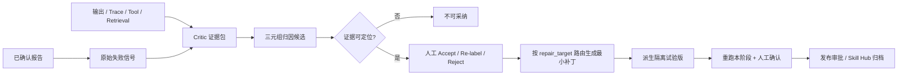

# Skill 自进化 V2 技术设计

## 1. 设计目标

在不破坏已有 `FailureAttribution.category` 和 Skill 派生链路的前提下，
增加一套面向“修改对象”的结构化归因协议。原始失败信号回答
“发生了什么”；新归因回答“为什么、证据在哪、应该改哪里”。

## 2. 整体数据流



## 3. 数据模型

### 3.1 `FailureAttribution` 兼容扩展

保留现有字段：

- `category`：原始失败信号，如 `prompt_error`、`generation_error`。
- `layer`：现有责任层，继续供历史查询与运行归因使用。

新增字段：

| 字段 | 用途 |
| --- | --- |
| `primary_cause` | 一级归因：`prompt_rules/context_rag/tools_logic/domain_knowledge/skill_schema` |
| `fine_cause` | 受控的二级归因枚举 |
| `repair_target` | `skill_sop/prompt/few_shot/tool_schema/workflow/code/knowledge/rag` |
| `evidence_status` | `unverified/verified/unresolvable` |
| `impact_scope` | JSON：文件、公共能力、Token 变化、风险级别 |
| `diagnosis_version` | Critic 协议版本，便于后续升级分类体系 |

`evidence` 仍使用 JSONField，但每项必须满足：

```json
{
  "evidence_id": "sha256 fingerprint",
  "type": "report_row | input_snapshot | decision_summary | tool_call | retrieval_hit | output_comparison",
  "source_id": "trace/span/report-row identifier",
  "source_hash": "sha256",
  "summary": "可审核摘要",
  "locatable": true,
  "payload_ref": "可选，大对象只存引用"
}
```

数据库约束：新字段允许空值以兼容历史数据；V2 Critic 新建的
`source=llm` 候选必须在服务层验证三元组与至少一条可定位证据。

### 3.2 补丁描述

沿用现有 `OptimizationProposal`，在 `change_patch` 中使用版本化结构：

```json
{
  "schema_version": "skill_patch/v2",
  "repair_target": "prompt",
  "operations": [
    {"path": "SKILL.md", "format": "unified_diff", "diff": "..."}
  ],
  "evidence_ids": ["..."],
  "impact": {
    "affected_files": ["SKILL.md"],
    "shared_capability": false,
    "estimated_token_delta": 80,
    "risk": "low"
  }
}
```

Tool/RAG 类先在隔离试验副本生成可执行补丁；通过相同输入的
Baseline/A/B 对照、人工选择与发布审批后，才能替换正式资产。

## 4. Critic Agent 协议

### 4.1 输入

1. 当前 Skill 精确版本的可修改文件摘要。
2. 全部报告缺陷分组及人工修改。
3. `GenerationOutput`、`RetrievalTrace`、`ExecutionSpan` 中可审计轨迹。
4. 往轮已采纳/已驳回的三元组归因。

### 4.2 输出

```json
{
  "candidates": [{
    "raw_signal": "prompt_error",
    "primary_cause": "skill_schema",
    "fine_cause": "precheck_missing",
    "repair_target": "skill_sop",
    "issue_type": "...",
    "hypothesis": "...",
    "confidence": 0.0,
    "evidence_refs": ["report:sheet:row", "span:uuid"],
    "counterevidence_refs": [],
    "impact_scope": {"risk": "low"}
  }]
}
```

### 4.3 确定性验证

LLM 输出后不直接落库，依次执行：

1. 枚举验证：三元组必须在服务端词表中。
2. 路由验证：`fine_cause -> allowed repair_targets` 必须合法。
3. 证据解析：每个 `evidence_ref` 必须能在证据包中命中。
4. 去重：指纹包含 output、证据指纹集、三元组。
5. 置信度上限：LLM 候选仍不得高于 0.8。

无证据、证据不可定位或路由不合法的候选不进入人工确认列表，
接口返回 `discarded_candidates` 及原因统计。

## 5. 人工审核与状态

- `Accept`：保留 Critic 三元组，进入 `confirmed`。
- `Re-label`：人工同时编辑一级归因、二级标签、修复层级和描述，以
  `source=human` 更新并保留 Critic 原值到 evidence 中。
- `Reject`：状态改为 `rejected`，保留记录供下轮去重。
- 只有 `confirmed + evidence_status=verified` 可生成补丁。

## 6. 补丁路由

| repair_target | 生成器 | 本期落地方式 |
| --- | --- | --- |
| `skill_sop` | SkillCreatorAdapter | 修改 Skill 副本中的 SOP/分支/兜底步骤 |
| `prompt` | PromptPatchGenerator | 生成 Prompt 文件最小 unified diff |
| `few_shot` | FewShotPatchGenerator | 生成正反例 JSON/Markdown 片段 |
| `tool_schema` | ToolPatchGenerator | 在工具试验副本中修改 JSON Schema / description |
| `workflow/code` | WorkflowPatchGenerator | 在隔离分支中生成流程/代码补丁 |
| `knowledge/rag` | KnowledgePatchGenerator | 在试验知识库中写入黄金事实/同义词/检索配置 |

现有 `SkillEvolutionService.derive_candidate` 扩展为变体编排器：

- Candidate A：使用最小 diff 生成 `exp.A`。
- Candidate B：调用预置 `skill-creator` 的结构优化流程生成 `exp.B`。
- Skill/Prompt/Few-Shot 变体落为不可变 Skill 包。
- Tool/Workflow/Knowledge/RAG 变体落为同一试验下的隔离资产快照。
- 每个变体拥有独立 sandbox 工作目录、补丁、指纹和回滚目标。

## 6.1 A/B Mutation 与评测编排

1. 对同一组已确认归因创建一个 experiment。
2. 从同一 baseline 并行生成 `exp.A` 与 `exp.B`，禁止变体互相作为基线。
3. 在三个隔离运行上下文中分别重跑 Baseline/A/B。
4. 本期生成对比原始指标和人工评定表；黄金数据集回归与自动聚合报告后续实现。
5. 人工选择 winner 后，只有 winner 可进入发布审批；loser 保留证据与状态。

## 7. API 设计

### 扩展现有接口

`POST /case-review-evolution/attributions/`

- 返回 V2 三元组、证据状态、影响面和丢弃统计。
- 保留旧字段 `category`，允许旧前端读取。

`POST /case-review-evolution/attributions/confirm/`

- `action=accept|relabel|reject`。
- `relabel` 必须同时提交 `primary_cause/fine_cause/repair_target/hypothesis`。
- 对旧客户端的 `edit` 作为 `relabel` 别名兼容。

### 新增接口

`GET /case-review-evolution/attribution-taxonomy/`

- 返回一级、二级和允许修复目标的唯一服务端词表。

`POST /case-review-evolution/patch-preview/`

- 仅接收已确认且证据验证通过的归因 ID。
- 返回最小 diff/项目级建议、影响面和是否可直接派生。

`POST /case-review-evolution/experiments/`

- 从同一 baseline 创建 A/B 变体和独立 sandbox。
- 返回每个变体的版本、diff、影响面、指纹和回滚点。

`POST /case-review-evolution/experiments/{id}/rerun/`

- 使用相同输入重跑 Baseline/A/B，记录隔离结果。

`POST /case-review-evolution/experiments/{id}/select-winner/`

- 记录人工对比结论，只将胜出变体送入发布审批。

## 8. 界面设计规格

### DESIGN SPECIFICATION

1. **Purpose Statement**：审核人需在一屏内回答“错在哪、证据是什么、要改哪里”，
   并完成 Accept / Re-label / Reject。界面优先保证证据与修复对象可核验，不追求装饰性。
2. **Aesthetic Direction**：Industrial / utilitarian，延续现有 Arco 企业工具界面。
3. **Color Palette**：沿用项目已有品牌/状态 token：主色 `#165DFF`、成功 `#16A34A`、
   风险 `#F59E0B`、拒绝 `#DC2626`、中性 `#86909C`。这是对 UI skill 默认禁色的窄范围品牌覆盖。
4. **Typography**：不新增外部字体，沿用平台已有 Arco 字体 token；代码/diff 使用
   `SFMono-Regular, Consolas, monospace`。这是为保持现有产品一致性的品牌覆盖。
5. **Layout Strategy**：候选项使用“左侧诊断主线 + 右侧证据抽屉”的非对称布局；
   一级归因、二级标签、修复目标按箭头链路展示，而非并列的彩色标签堆。

### 候选审核项结构

1. 顶部：原始信号（弱化）、置信度、证据验证状态。
2. 主线：`一级归因 -> 二级原因 -> 修复目标`。
3. 正文：Critic 诊断及建议的最小改动。
4. 证据：右侧抽屉展示证据类型、来源、摘要、可定位状态。
5. Re-label：行内级联选择一级、二级、修复层级，并编辑诊断描述。
6. 无可定位证据的项只显示在“已丢弃诊断”摘要，不提供采纳按钮。

## 9. 权限与安全

- 证据读取沿用 output/trace 所在项目的成员权限。
- API 不返回隐藏 CoT，只返回可审计的决策摘要。
- 大 Payload 只返回脱敏摘要与后端引用。
- 重新标注、补丁确认与发布必须记录操作人和时间。

## 10. 测试策略

1. 词表单元测试：所有二级标签都有合法修复路由。
2. Critic 合约测试：非法枚举、无证据、不可定位证据会被丢弃。
3. 兼容测试：旧归因可继续读取，旧 `edit` 动作可继续使用。
4. 人工闸口测试：未确认或证据未验证的归因不能生成补丁。
5. 补丁路由测试：Skill 包内目标可派生，Tool/RAG 目标只生成项目级建议。
6. 不可变性测试：候选生成、重跑与失败都不改 active Skill 指纹。
7. 前端交互测试：三元组展示、证据抽屉、Re-label 级联、丢弃项摘要。
